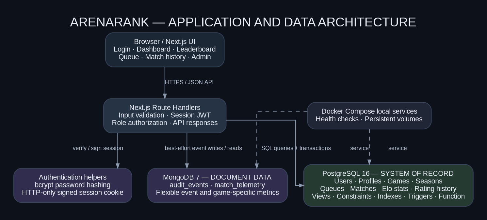
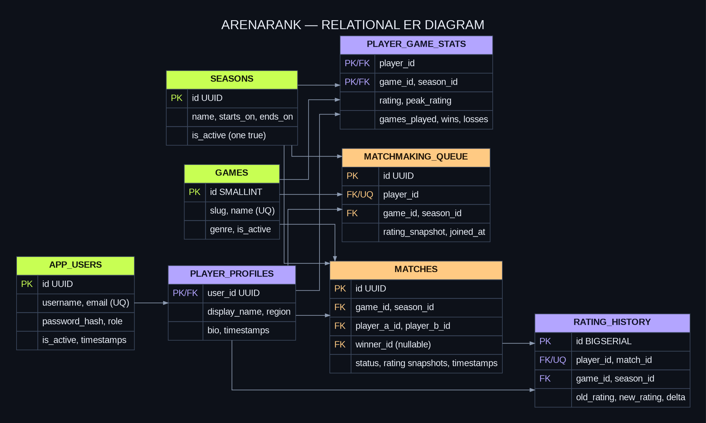

# COMPETITIVE ESPORTS MATCHMAKING & ELO LEADERBOARD PLATFORM

**DBMS Experiential Learning – Level 3 Project**  
**Department of Computer Science and Engineering**  
**Project Name:** ArenaRank  
**Student 1:** Srujan Javaregowda — PES2UG24CS526  
**Student 2:** Sushant Hiremath — PES2UG24CS542  
**Course Instructor:** Dr. Nagasundari S.  
**Academic Year:** 2026–2027

> **Submission finalization:** Confirm the project title is unique within the section and add the live execution screenshots required by the course. The seeded players, outcomes and telemetry are synthetic demonstration data.

---

## Abstract

Competitive esports platforms need more than player registration and static leaderboards. They need to pair players of comparable skill, maintain transparent ratings after completed matches, prevent inconsistent results, and preserve enough history to explain rating movement. ArenaRank is a web-based academic prototype that addresses these needs through rating-aware matchmaking and per-game, per-season Elo rankings.

The application uses Next.js and TypeScript for the web interface and API layer. PostgreSQL stores user identity, profile data, games, seasons, ratings, matchmaking queue entries, matches and rating history. Its relational constraints, indexes, triggers, view, transaction boundaries and stored Elo function enforce consistency. MongoDB stores flexible match telemetry and append-only activity events, where fields may vary by game or event type. The interface supports player registration, login, leaderboard search, joining/leaving matchmaking, match history and an administrator workflow to finalize results.

The central design decision is to keep official competitive state in PostgreSQL and use MongoDB for document-shaped supplementary data. When an administrator finalizes a match, the database locks the match and relevant rating rows, calculates both Elo changes, updates the player records, inserts two rating-history entries and marks the match complete in one transaction. This prevents a half-updated competitive result. Automated Elo unit tests and a manual integration test plan are included; actual integration and build outcomes should be recorded after executing the steps on the submission machine.

## 1. Introduction and Problem Definition

### 1.1 Problem statement

Players in competitive esports need fair opponents and a leaderboard that reflects match results rather than manual edits. A simplistic application that only inserts, displays, updates and deletes players does not solve this problem. It also cannot reliably handle simultaneous queue requests, ensure that the declared winner is a participant, keep ratings consistent with match results, or reconstruct a player's rating changes.

The proposed platform matches two eligible players in the same game and active season when their Elo ratings are within a configurable range. It records the match as pending until an administrator confirms the winner. PostgreSQL then calculates and commits the rating movement alongside the official result. Leaderboard positions derive from committed records, and rating history explains how each rating changed. MongoDB stores variable telemetry and activity details without forcing game-specific metrics into the relational schema.

### 1.2 Objectives

1. Build a functional Next.js web interface with player and administrator workflows.
2. Design a normalized relational schema with clear entities, keys, relationships, checks and indexes.
3. Implement rating-aware matchmaking with transactional queue management.
4. Implement Elo-based rating updates and immutable per-match rating history.
5. Demonstrate advanced PostgreSQL features: transactions, a view, stored function, triggers, indexes, full-text search, aggregates and window functions.
6. Integrate MongoDB for flexible event documents and game-specific telemetry, including useful indexes and aggregation examples.
7. Implement authentication, role-based authorization, validation and environment-based database configuration.
8. Provide reproducible setup instructions, SQL queries, diagrams, test cases and team contribution evidence.

### 1.3 Scope

The prototype supports one active season at a time, multiple games, two-player head-to-head matches, a simple Elo variant, a rating-gap queue, an admin-controlled result workflow, a player directory and a compact activity feed. It does not connect to real game servers, automatically verify game results, manage tournaments or teams, support draws, or process real game telemetry streams. Synthetic seed records are used to make the interface demonstrable before players generate their own data.

## Submission evidence

The following screenshots were captured from the seeded local application on 4 November 2026:

1. [Login screen](./assets/01_login.png)
2. [Player dashboard](./assets/02_player_dashboard.png)
3. [Leaderboard search view](./assets/03_leaderboard_search.png)
4. [Joined matchmaking queue](./assets/04_queue_joined.png)
5. [Completed match history](./assets/05_match_created.png)
6. [Admin pending-results console](./assets/06_admin_pending_match.png)
7. [Completed-result ledger](./assets/07_result_finalized.png)
8. [Rating-change ledger](./assets/08_postgres_rating_history.png)
9. [MongoDB audit-events console](./assets/09_mongodb_audit_events.png)
10. [Typecheck, Elo test, and build output](./assets/10_test_output.png)

The admin screenshot records the actual seeded state of zero pending matches, while the completed-result and rating-ledger screenshots show the existing committed fixtures. The UI captures are evidence of the live application; direct database-shell output was not substituted or fabricated.

## 2. User Roles and Requirements

### 2.1 Roles

| Role | Main capabilities | Restrictions |
|---|---|---|
| Player | Register, sign in/out, view own stats, browse/search leaderboard, join or leave queue, inspect match history | Cannot assign their own role as admin or finalize official results |
| Administrator | View platform-wide pending matches, finalize match results, inspect MongoDB activity feed and all recent matches | Must be authenticated; result endpoint checks the role on the server |

### 2.2 Functional requirements

- **FR-01 Account management:** validate email, username, display name and password; hash passwords using bcrypt.
- **FR-02 Authentication:** issue a signed HTTP-only session cookie after valid sign-in; support sign-out.
- **FR-03 Authorization:** enforce at least two roles; player-only endpoints protect queue operations and admin-only route protects result finalization.
- **FR-04 Game and season selection:** maintain multiple active games and separate ratings for each game and season.
- **FR-05 Leaderboard:** rank players by Elo, then wins, then display name; show current rating, peak rating, match record and win percentage.
- **FR-06 Matchmaking:** pair a player with the nearest rating candidate from the same game/season within ±300 Elo, using queue age to break ties.
- **FR-07 Queue cancellation:** allow a signed-in player to remove their own queue entry.
- **FR-08 Match result:** only an administrator can finalize a pending match, and the chosen winner must be one of its participants.
- **FR-09 Rating history:** store old rating, new rating and signed delta for both participants of each completed match.
- **FR-10 Search:** search display names, handles and profile text.
- **FR-11 Activity/telemetry:** store activity as MongoDB documents and support recent activity retrieval in the admin console.

### 2.3 Non-functional requirements

- **Integrity:** keys, constraints, transaction boundaries, triggers and a database function prevent inconsistent official results.
- **Security:** no hard-coded production secret; database credentials are read from environment variables; passwords are hashed; role checks run server-side.
- **Usability:** dashboard cards and focused pages expose rating, win rate, leaderboard, queue and match status.
- **Maintainability:** table schema, API routes, seed script, data dictionary and tests are separated into understandable files.
- **Demonstrability:** Docker Compose provides reproducible local PostgreSQL and MongoDB services; seeded demo users make the primary journeys visible.

## 3. System Architecture

The browser talks to Next.js Route Handlers through JSON requests. The API verifies a signed session token, checks role requirements, validates inputs, and accesses both databases from the server. PostgreSQL is the authoritative store for official competitive state. MongoDB provides a supplementary document store. Database secrets are read from environment variables and are not sent to the browser.



### 3.1 Main processing flows

**Matchmaking flow**

1. A player selects a title and joins the queue.
2. The API begins a PostgreSQL transaction and checks the title and active season.
3. It reads the player's per-game/per-season rating and searches for a compatible queue entry with the same game and season.
4. Candidates within ±300 rating are ordered by smallest rating gap and oldest queue timestamp. The candidate row is locked to reduce duplicate pairings under concurrency.
5. If a candidate exists, one pending match is inserted and both queue entries are deleted before commit. Otherwise, the new queue entry is inserted.
6. An activity event is written to MongoDB after the SQL transaction.

**Result finalization flow**

1. An admin chooses one of the two participants as winner.
2. The API calls `finalize_match` inside a transaction.
3. The function locks the match and both corresponding rating records, validates the winner, computes Elo changes, updates counters, inserts two history rows and marks the match completed.
4. A validation or SQL error aborts the transaction, avoiding partial rating changes.
5. The admin activity event is written to MongoDB after commit and the refreshed leaderboard reflects the committed SQL state.

## 4. Database Selection and Justification

### 4.1 PostgreSQL (mandatory SQL database)

PostgreSQL is appropriate for official match state because the data has strong relationships and integrity requirements. Foreign keys connect players, games, seasons and matches; check constraints enforce valid ratings, distinct participants and valid completion fields; unique constraints prevent duplicate identities and duplicate player-match history rows. Transactions ensure the match, rating counters and history move together. A stored function performs the Elo update close to the data, while a view and window function provide consistent rankings.

### 4.2 MongoDB (NoSQL database)

MongoDB is appropriate for optional telemetry and activity event documents whose shape can evolve between games. The application stores structured event metadata and flexible metrics such as map, round count, duration and game-specific counters. MongoDB is not used for player Elo or official match winners because those facts require relational integrity and atomic updates.

### 4.3 Why a vector database is not selected

The project does not require semantic retrieval of long text. Match eligibility is determined by numeric rating gap, game ID, season ID and queue time. A vector database would not improve this core operation and would add an unjustified technology. Full-text player search is handled with PostgreSQL's GIN-indexed text search.

## 5. Database Design

### 5.1 ER diagram



The relational model contains eight main tables: `app_users`, `games`, `seasons`, `player_profiles`, `player_game_stats`, `matchmaking_queue`, `matches`, and `rating_history`. MongoDB collections are documented separately in Section 7.

### 5.2 Entity relationships

- One app user may have zero or one player profile; an administrator does not need a profile.
- One player profile can have multiple rating records, one per game and season.
- Each `player_game_stats` record belongs to exactly one player, game and season.
- A player may have zero or one active queue entry; a queue entry belongs to one game and one season.
- Every match has two distinct player participants, one game and one season. Winner is null until finalization.
- Each completed match creates exactly two rating-history entries, one for each participant.
- A leaderboard row is derived from `leaderboard_view`; it is not redundantly maintained as a separate table.

### 5.3 Relational schema

- `APP_USERS(**id**, username UNIQUE, email UNIQUE, password_hash, role, is_active, created_at, updated_at)`
- `GAMES(**id**, slug UNIQUE, name UNIQUE, genre, is_active, created_at)`
- `SEASONS(**id**, name UNIQUE, starts_on, ends_on, is_active, created_at)`
- `PLAYER_PROFILES(**user_id** FK, display_name, region, bio, created_at, updated_at)`
- `PLAYER_GAME_STATS(**player_id** FK, **game_id** FK, **season_id** FK, rating, peak_rating, games_played, wins, losses, updated_at)`; composite primary key on the first three identifiers.
- `MATCHMAKING_QUEUE(**id**, player_id UNIQUE FK, game_id FK, season_id FK, rating_snapshot, joined_at)`
- `MATCHES(**id**, game_id FK, season_id FK, player_a_id FK, player_b_id FK, winner_id FK nullable, status, before/after ratings, created_at, completed_at)`
- `RATING_HISTORY(**id**, player_id FK, match_id FK, game_id FK, season_id FK, old_rating, new_rating, delta, created_at)`; unique `(player_id, match_id)`.

See `data_dictionary.md` and `db/schema.sql` for field descriptions and executable DDL.

### 5.4 Normalization and integrity

Identity, profile, game, season, match and rating history are split into separate relations, avoiding repeated profile data in the match row. Game and season names are stored once and referenced by keys. The player's current game/season rating is in `player_game_stats`; the historical rating change is in `rating_history`. `leaderboard_view` computes rank at query time to avoid stale duplicated ranking data.

Key database constraints include unique username/email, role check, single active season, rating range 100–4000, `wins + losses = games_played`, a valid two-player fixture, winner-is-participant, rating delta consistency, and completed-match field consistency. Application validation gives user-friendly errors, but database integrity rules remain authoritative.

## 6. Elo Rating and Matchmaking Algorithms

### 6.1 Expected score

For player A with rating \(R_A\) and player B with rating \(R_B\), the expected score for A is:

\[
E_A = \frac{1}{1 + 10^{(R_B - R_A)/400}}
\]

Player B's expected score is \(E_B = 1-E_A\). A win receives score 1 and a loss receives score 0. With K-factor 32, the new rating is:

\[
R'_A = R_A + 32(S_A-E_A), \qquad R'_B = R_B + 32(S_B-E_B)
\]

The database rounds to integer ratings and clamps results to the 100–4000 integrity range. This prototype does not support draws and uses a constant K-factor for easier demonstration; a production policy might vary K by player experience or tournament rules.

### 6.2 Matchmaking algorithm

1. Filter to queue records with matching `game_id` and `season_id`.
2. Exclude the requesting player.
3. Keep only candidates satisfying `ABS(candidate_rating - entrant_rating) <= 300`.
4. Sort by rating gap ascending, then `joined_at` ascending.
5. Lock the best candidate using `FOR UPDATE SKIP LOCKED`.
6. Insert a pending match and delete both queue rows in the same transaction. If there is no candidate, create a queue row for the entrant.

This is an intentional MVP policy. The rating threshold can later widen with wait time, include region/ping limits, or be made configurable by game.

## 7. Advanced SQL and NoSQL Features

| Requirement / concept | Implementation | Why it matters |
|---|---|---|
| DDL | `CREATE TABLE`, `ALTER TABLE` in safe DDL demo, trigger/view/function creation, `DROP TABLE` temp demo | Demonstrates schema lifecycle statements |
| Constraints | PKs, FKs, UNIQUE and CHECK constraints | Prevents invalid or orphaned data |
| Transactions | queue/match creation; match result finalization | Avoids half-created pairings or partial rating updates |
| View | `leaderboard_view` | Reusable ranked player result without duplicated leaderboard storage |
| Stored function | `finalize_match` | Centralizes Elo logic and atomically updates results/history |
| Triggers | `set_updated_at`; `validate_match_participants`; `prevent_rating_history_mutation` | Maintains timestamps, validates match setup and protects append-only rating history |
| Indexes | B-tree indexes for queue, matches and history; GIN full-text index | Accelerates common filters, histories and player search |
| Aggregation | `COUNT`, `SUM`, `AVG`, `GROUP BY`, `HAVING` in demo queries | Enables performance summaries |
| Window function | `RANK() OVER (PARTITION BY game_id, season_id...)` | Produces competitive rank within each ladder |
| NoSQL indexes | Mongo indexes on actor/date, entity/date, match and game | Supports recent event and telemetry retrieval |
| NoSQL aggregation | Group recent activity by action or telemetry by game | Supports operational summary without rigid document schema |

The safe `db/ddl_demo.sql` uses a temporary table and rolls back, so the `DROP` demonstration does not delete project data. `docs/important_queries.sql` contains join, aggregate, filter, subquery, ranking, full-text, transaction and index-inspection examples.

## 8. Application and API Implementation

The application uses Next.js App Router and Route Handlers. Server routes read database connection strings from environment variables. The browser never connects directly to either database.

| Method | Route | Access | Responsibility |
|---|---|---|---|
| POST | `/api/auth/register` | Public | Validate values, hash password, create `PLAYER` and initialize profile/rating stats |
| POST | `/api/auth/login` | Public | Verify bcrypt hash and create signed HTTP-only cookie |
| POST | `/api/auth/logout` | Signed in | Clear session cookie |
| GET | `/api/auth/me` | Session-aware | Check session and account status |
| GET | `/api/dashboard` | Signed in | Retrieve dashboard statistics, leaderboard, queue and match records; admin can see pending matches and audit feed |
| GET | `/api/players` | Signed in | Search profiles by display name, handle or full-text profile text |
| POST | `/api/queue/join` | Player | Join queue or create match with a compatible candidate |
| POST | `/api/queue/leave` | Player | Delete the caller's queue entry |
| POST | `/api/matches/{id}/result` | Admin | Call the SQL Elo function for a selected winner |

The frontend provides login/registration, overview cards, leaderboard search, matchmaking, match history, and an admin console. Status and actions are returned by the API and reflected after refresh. The core interface uses custom CSS and standard HTML controls, avoiding a fragile dependency on a large UI framework for this project.

## 9. Testing and Validation Plan

The package contains automated Elo tests (`tests/elo.test.mjs`) for equal-rated match movement, upset behavior, input validation and rating bounds. Run them with `npm run test:elo`. Run `npm run typecheck` and `npm run build` to validate the TypeScript and production build.

The manual test matrix in `test_cases.md` covers authentication, registration validation, role checks, queue behavior, result integrity, leaderboard refresh, MongoDB events, telemetry, SQL demo queries and build verification. The matrix intentionally says `Not run` until the commands and UI cases have been executed on the actual machine. Attach screenshots and actual outputs before submission; the existence of a planned test is not evidence that it passed.

## 10. Setup and Execution

Prerequisites are Node.js 20+, npm, Docker Desktop and Docker Compose.

```powershell
Copy-Item .env.example .env
# Edit .env: use a random SESSION_SECRET with at least 32 characters.
docker compose up -d
npm install
npm run seed
npm run dev
```

Open `http://localhost:3000`. Local demo accounts are `player1@esports.local` / `Player123!` and `admin@esports.local` / `Admin123!`. These are demonstration credentials only. The full command sequence, database reset warning, troubleshooting and demo script are in `README.md`.

## 11. Security and Ethical Considerations

The project hashes passwords rather than storing plaintext. Session tokens are signed and placed in HTTP-only cookies, registration cannot choose an admin role, and the match result API checks for an administrator. Database constraints are used independently of client-side form validation. `.env` is excluded from version control.

The app is an academic prototype. It does not include email verification, login throttling, a full CSRF/rate-limiting defense, anti-cheat verification, production secret storage or tested backup/restore automation. Before exposing it to the public internet, use HTTPS, change the local database credentials, configure managed secrets, add operational monitoring and backups, rate-limit sensitive endpoints, and design trusted result verification. Synthetic results and game telemetry must be identified as demo data.

## 12. Limitations and Future Work

- The pairing engine currently handles two-player matches and a fixed ±300 Elo window.
- Official results are entered by an admin; a real platform would verify match outcomes from trusted game APIs or signed tournament reports.
- K-factor is fixed at 32, ratings are integer-valued, and draws are unsupported.
- The current activity writes to MongoDB after SQL commit on a best-effort basis. A transactional outbox and retrying worker would improve delivery reliability.
- Region is stored, but region/ping is not yet a matchmaking filter.
- Match telemetry is schema-flexible and seeded with synthetic metrics; no actual telemetry ingestion pipeline is included.
- Further work could add seasons administration UI, rating-gap widening based on wait time, tournament brackets, teams, anti-cheat flags, player reports, richer analytics, and automated integration tests.

## 13. Team Contributions

Use `team_contributions.md` to record the actual division of work. It is a proposal template, not evidence of work already completed. Both members should be able to explain both the database schema and the application/database integration, and Git history should show authentic individual contributions.

## Conclusion

ArenaRank addresses a substantive competitive-platform problem through transactional matchmaking and a reproducible Elo-rating workflow rather than a basic CRUD interface. It maps database concepts directly to requirements: PostgreSQL enforces official relational state; a view produces seasonal rankings; a stored function performs atomic rating updates; triggers and constraints protect data integrity; indexes support queueing, histories and search; and MongoDB stores evolving telemetry and operational activity. The package includes executable source, database setup, a seed routine, diagrams, schema/query documentation, test cases and a demonstration guide. Final hand-in quality depends on the team completing the clearly marked local execution, screenshot and team-member details, then recording actual test outcomes.
